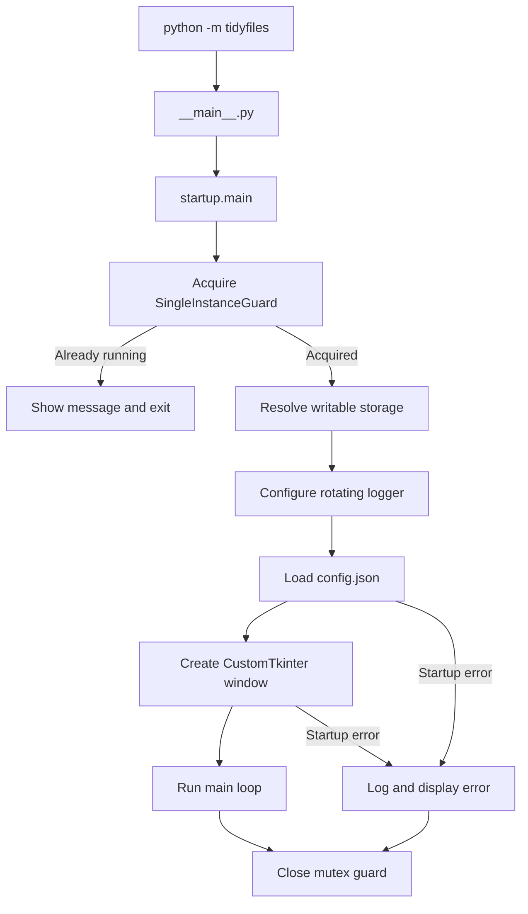

# Architecture

TidyFiles currently consists of a small Python package with a Windows desktop
shell and foundational startup, configuration, storage, logging, and
single-instance modules. The pure filename engine is implemented as a library
component but is not connected to the GUI. Collection, preview, destination
planning, and filesystem processing remain planned.

## Startup and shutdown

The second-instance path ends before storage selection, logging, configuration
loading, or GUI import. The guard remains held through the GUI event loop and is
released on orderly shutdown. Bringing an existing window to the foreground is
not implemented.

## Package components

| Module | Current responsibility |
| --- | --- |
| `src/tidyfiles/__init__.py` | Package version. |
| `src/tidyfiles/__main__.py` | `python -m tidyfiles` entry point. |
| `src/tidyfiles/startup.py` | Mutex-first startup, storage/config/log initialization, error reporting, GUI launch, and orderly guard cleanup. |
| `src/tidyfiles/instance.py` | Windows named-mutex acquisition, active-owner rejection, abandoned-mutex recovery, and handle cleanup. |
| `src/tidyfiles/storage.py` | Writable application-directory selection and `%LOCALAPPDATA%\TidyFiles` fallback for ordinary application data. |
| `src/tidyfiles/config.py` | Schema-v1 configuration defaults, validation, loading, and atomic saving. Loading invalid configuration reports an error without rewriting it. |
| `src/tidyfiles/logging_setup.py` | Rotating log setup with a 5 MB active file, three backups, and a no-op fallback when file logging cannot be opened. |
| `src/tidyfiles/app.py` | System-appearance CustomTkinter shell, three operation tabs, one initially empty shared Treeview, and status text. |
| `src/tidyfiles/filename_format.py` | Pure parser producing immutable, source-ordered literal spans and token occurrences; structured parse errors retain the exact input expression, offset, and optional offending token. |
| `src/tidyfiles/filename_evaluator.py` | Pure per-file and ordered-batch evaluation of parsed tokens and extensions; returns raw values, resolved candidates, validated names, and file-specific diagnostics. |
| `src/tidyfiles/filename_validation.py` | Pure legacy-character substitution and validation of one Windows filename component, including reserved device names, Unicode safety, and UTF-16 component length. |

The shell does not import files, maintain a file collection, evaluate parsed
rename formats in the GUI, hash duplicates, repack media, or modify the
filesystem. The pure `filename_evaluator.py` module consumes an existing parsed
expression and immutable per-file metadata. It evaluates literal text, original
stems, text extraction and manipulation, stored directory names, supplied
physical counts, collection sequences, and source/output extension context.
Manipulations update a separate working stem in source order and emit each
resulting stem at that token's position. Batch evaluation derives zero-based
indexes from its ordered snapshot, normalizes Windows parent identities without
filesystem access, and reports per-file failures. Numeric widths are at least
two digits; repeated numeric occurrences share width, with `<IncNrDir>` widths
calculated separately for each parent group. `<Ext>` emits the source extension
except for terminal `.<Ext>`, which emits the intended output extension.
Extension assembly recognizes only terminal literal suffixes matching the
source or intended output extension. Each batch result retains raw evaluated
text, its extension-resolved candidate, and (when valid) the sanitized filename
separately. The nine legacy invalid characters are substituted after evaluation;
emitted text is not parsed again. Other Unicode code points and their
normalization form are preserved. Validation rejects empty or whitespace-only
names, empty generated stems, `.`/`..`, trailing ASCII spaces or periods,
controls, invalid Unicode, overlong components, and reserved DOS device
basenames (`CON`, `PRN`, `AUX`, `NUL`, `CONIN$`, `CONOUT$`, `COM1`–`COM9`,
`LPT1`–`LPT9`, and COM/LPT superscript `¹`, `²`, and `³` forms), including
device basenames followed by extensions or multiple dotted suffixes. Component
length counts the final extension and separator in UTF-16 code units, with a
default limit of 255. Batch validity fails if any evaluation, extension, or
filename validation error occurs, and an empty format cannot authorize a rename
batch. Validated candidates are still not an executable filesystem plan. The
validator does not inspect target volumes, enforce full-path limits, check
collisions, or access the filesystem.
Source and target extensions may be supplied with or without a leading dot;
their supplied spelling is preserved in candidates. An empty extension means
the source or intended output has no suffix, while `None` means metadata is
unavailable.
The parser preserves commas in final `RepS`, `RepM`, and `Ins` arguments, and
evaluation uses them verbatim.

## Tests and CI

Tests are in `tests/` and use pytest. Configuration, storage, logging, package
startup, and Windows mutex behavior have focused coverage. Windows-specific
mutex tests use independent subprocesses and temporary directories; startup
tests use isolated temporary paths and fakes so they do not require a visible
desktop.

`.github/workflows/ci.yml` runs on `windows-latest`, sets up Python 3.13,
installs `.[dev]`, then runs Ruff and pytest. It does not run `compileall`.

## Planned components

Actual directory enumeration and count caching, the shared collection and
scanning services, destination planner and filesystem transaction layer,
duplicate verification, and repacker are future components. Their behavior is
specified in local planning references, not implemented in this package. Do not
infer implementation status from an approved requirement.
