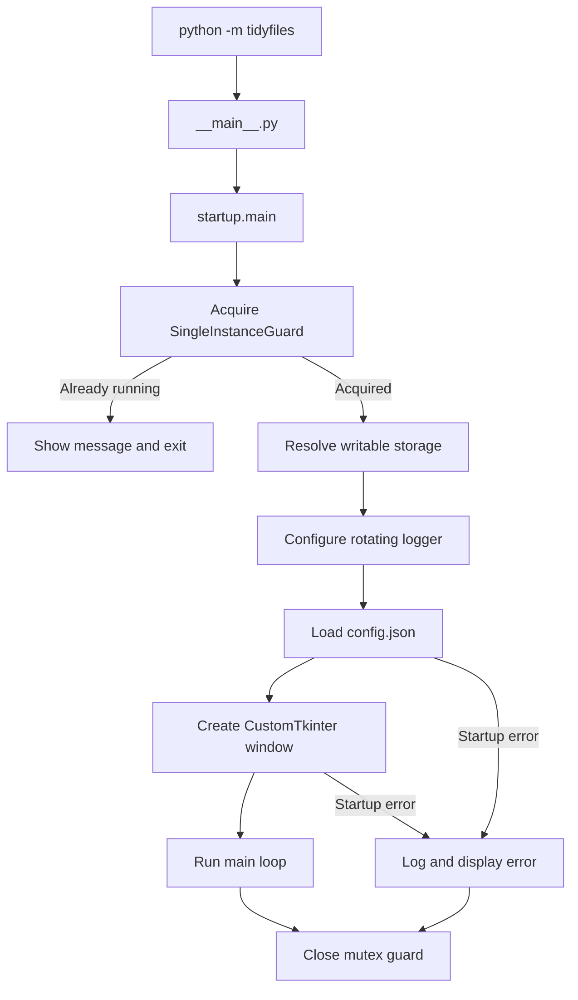

# Architecture

TidyFiles currently consists of a small Python package with a Windows desktop
shell and foundational startup, configuration, storage, logging, and
single-instance modules. The pure filename engine evaluates finalized ordered
collection snapshots, and Bulk Rename displays its read-only previews through
the existing GUI. The shared in-memory collection supports import finalization
or rollback, sorting, manual ordering, selection, removal, and clearing. File
discovery and filename evaluation run in background services while all Tk
updates stay on the main thread. Separate read-only services plan destinations
and revalidate reviewed plans. The standalone Windows rename executor is
available to controlled callers.

## Startup and shutdown

The second-instance path ends before storage selection, logging, configuration
loading, or GUI import. The guard remains held through the GUI event loop and is
released on orderly shutdown. Bringing an existing window to the foreground is
not implemented.

## Package components

| Module | Current responsibility |
| --- | --- |
| `src/tidyfiles/__init__.py` | Package version. |
| `src/tidyfiles/__main__.py` | `python -m tidyfiles` entry point. |
| `src/tidyfiles/startup.py` | Mutex-first startup, storage/config/log initialization, error reporting, GUI launch, and orderly guard cleanup. |
| `src/tidyfiles/instance.py` | Windows named-mutex acquisition, active-owner rejection, abandoned-mutex recovery, and handle cleanup. |
| `src/tidyfiles/storage.py` | Writable application-directory selection and `%LOCALAPPDATA%\TidyFiles` fallback for ordinary application data. |
| `src/tidyfiles/config.py` | Schema-v1 defaults, validation, loading, and atomic saving, including independent, default-off Auto-clean and Auto-Clear Trash settings. Invalid sort values use defaults without rewriting the file during load; other invalid configuration remains an error. |
| `src/tidyfiles/logging_setup.py` | Rotating log setup with a 5 MB active file, three backups, and a no-op fallback when file logging cannot be opened. |
| `src/tidyfiles/app.py` | CustomTkinter main window, three mode panels, one shared collection-backed Treeview, collection controls, debounced filename previews and diagnostics, column customization, appearance, and window geometry preferences. |
| `src/tidyfiles/import_controller.py` | One active discovery session, Tk-thread result consumption, bounded incremental rendering, asynchronous final-order preparation, cancellation rollback, and shutdown coordination. |
| `src/tidyfiles/ui_preferences.py` | Per-mode Treeview column defaults and safe preference recovery, plus window-geometry parsing and virtual-screen clamping. |
| `src/tidyfiles/collection.py` | GUI-independent working collection with one authoritative ordered ID sequence, indexed membership, import lifecycle, management operations, ordering mode, and immutable snapshots. |
| `src/tidyfiles/discovery.py` | Read-only file and recursive folder discovery, exclusions, metadata snapshots, one bounded background producer, batched collection updates, cooperative cancellation, and complete/incomplete/failed outcomes. |
| `src/tidyfiles/sorting.py` | Pure sort criteria, directions, natural comparison keys, legacy file categories, and deterministic ordering without filesystem access. |
| `src/tidyfiles/filename_format.py` | Pure parser producing immutable, source-ordered literal spans and token occurrences; structured parse errors retain the exact input expression, offset, and optional offending token. |
| `src/tidyfiles/filename_evaluator.py` | Pure per-file and ordered-batch evaluation of parsed tokens and extensions; returns raw values, resolved candidates, validated names, and file-specific diagnostics. |
| `src/tidyfiles/filename_integration.py` | Collection-snapshot adapter, read-only directory-count cache, structured evaluation results, request-currency checks, cooperative cancellation, progress, and one bounded background worker. |
| `src/tidyfiles/format_reference.py` | Categorized parser-valid token insertion examples and the read-only filename-format reference text. |
| `src/tidyfiles/filename_validation.py` | Pure legacy-character substitution and validation of one Windows filename component, including reserved device names, Unicode safety, and UTF-16 component length. |
| `src/tidyfiles/destination_planning.py` | Read-only batch planning from a finalized snapshot and current filename evaluation, collision and dependency classification, and collision-only subset replanning. |
| `src/tidyfiles/destination_observation.py` | Literal local Windows path, ancestor, volume, directory case, and occupancy observations. |
| `src/tidyfiles/execution_preflight.py` | Review-time identity capture, full-batch refresh, and read-only identity, destination and exact-set revalidation. |
| `src/tidyfiles/preflight_service.py` | A bounded preflight worker with replacement, cancellation, progress, and current-result tracking. |
| `src/tidyfiles/transaction_record.py` | Versioned transaction records, Windows identity encoding, and finalization evidence validation. |
| `src/tidyfiles/transaction_journal.py` | Pinned journal sessions, atomic persistence, the independent recovery locator, and read-only discovery. |
| `src/tidyfiles/recovery.py` | Read-only current recovery observations and path/identity overlap protection for modifying services. |
| `src/tidyfiles/cleanup.py` | Snapshot-scoped Auto-clean, temporary artifact cleanup, and guarded managed Trash clearing. |
| `src/tidyfiles/windows_cleanup.py` | No-reparse directory enumeration and identity-bound deletion of files or verified empty directories. |
| `src/tidyfiles/modifying_jobs.py` | Exclusive job reservation and preparation, modification, cancellation, and closure state. |
| `src/tidyfiles/rename_executor.py` | Authorized scope binding, sequential dependency execution, journal checkpoints, and verified results. |
| `src/tidyfiles/windows_rename.py` | Handle-relative, non-overwriting Windows rename and creation-time preservation. |
| `src/tidyfiles/managed_trash.py` | Explicit Trash scope, centralized batch naming, transfer sequencing, and verified results. |
| `src/tidyfiles/windows_trash.py` | Handle-relative batch creation, exclusive cross-volume copy, metadata and content checks, and guarded source removal. |
| `src/tidyfiles/filesystem_paths.py` | Shared Windows system path and clutter-name exclusions. |

The GUI imports selected files and recursively selected folders by reading
metadata, without opening file contents. Import updates the shared collection
and table progressively. After the import is finalized, Bulk Rename can evaluate
the complete ordered collection without reading file contents. No mode hashes
duplicates, repacks media, or modifies the filesystem.
`collection.py` stores the selected path spelling and a separate
case-insensitive, normalized Windows path key without resolving paths or
accessing the filesystem. Filesystem object identity is optional metadata and
does not merge distinct paths. Add Folder entries retain that folder as their
first import root, while Add Files entries use each file's immediate parent;
separate Add Folder root records carry cleanup authorization. Import sessions
append provisional entries, then finalize them or remove only their own new
entries and roots on cancellation. Effective order changes do not change entry
IDs, and downstream consumers receive immutable ordered snapshots. The model
does not modify source files. `discovery.py` uses one background producer with
a 128-record queue and a default batch size of 64; only the consumer registers
results in the collection. It reports progress counters without a percentage,
and does not materialize a folder's candidate paths before traversal. Discovery
excludes the three named clutter files case-insensitively, `$RECYCLE.BIN`,
`System Volume Information`, nonregular entries, and observed reparse points.
Discovery and native planning exclude the application directory's managed
Trash. Callers supply additional managed locations through the
`managed_paths` argument. Ordinary hidden and dot-prefixed files remain
eligible. Metadata includes size, timestamps, attributes, and
filesystem identity when available; Windows directory-entry identity is
re-read without following links when the initial entry data lacks a file ID.
Coverage errors produce an incomplete import while retaining discovered
entries; exclusions do not. Cancellation drains queued work, rejects later
results, and rolls back the current import after the producer stops. The
collection retains earlier incomplete-import records. Discovery order is
provisional until all results are consumed and the import is finalized. The
collection then either sorts all retained entries in automatic mode or keeps
existing order and appends the new entries sorted in manual mode. The default
sort is File Type + Name, ascending, using the legacy image, video, document,
audio, archive, and other categories. Name, extension, size, creation date,
modified date, and path are also supported. Descending reverses the complete
known compound key, including category order; ascending preserves the legacy
category order. Missing metadata sorts after known values in both directions;
known zero values remain ordinary sortable values. The legacy HEIC suffix is
an image sort category only; this does not add conversion support.

Natural comparison case-folds text and compares decimal runs by numeric value
without converting long runs to integers. Numerically equivalent padded names
use a deterministic case-sensitive filename and then natural full-path,
normalized-path, and original-path tie-breakers. For example, `Image 001.png`,
`Image 01.png`, and `Image 1.png` sort in that order. Sorting keys use only
stored collection values and never read the filesystem. Persistent criterion
and direction live in
`global_settings.sort_criterion` and `global_settings.sort_direction`; missing
or invalid values use File Type + Name, ascending. Manual mode is collection
state and is not saved as a preference.

The collection exposes Move Up, Move Down, Move to Top, Move to Bottom, and
complete ordered-ID replacement. Multi-selection is treated as a set while
selected order comes from the collection; relative order is preserved for both
selected and unaffected entries. Unknown selection IDs are ignored, while an
invalid complete permutation is rejected. Remove from List changes only
in-memory membership and retains import-root records and incomplete warnings.
Clear All removes collection entries, import records, roots, and diagnostics,
resets automatic mode, and retains sort preferences. Both actions leave source
files untouched. Management capabilities disable sort, reorder, removal, and
clear while an import is active. No final processing-readiness gate is exposed.

Each immutable snapshot carries a monotonic revision. `is_current(snapshot)`
checks collection identity and revision so membership or effective-order
changes, including canceled imports, invalidate downstream results without
reusing a prior revision. No-op reorder and removal operations do not advance
the revision. M2-E2 presents this collection progressively through one shared
Treeview. M2-E3 connects collection management to the same model rather than
maintaining feature-specific order or membership state.
The scan is a metadata snapshot and does not replace M3 execution-time
revalidation. The pure
`filename_evaluator.py` module consumes an existing parsed
expression and immutable per-file metadata. It evaluates literal text, original
stems, text extraction and manipulation, stored directory names, supplied
physical counts, collection sequences, and source/output extension context.
Manipulations update a separate working stem in source order and emit each
resulting stem at that token's position. Batch evaluation derives zero-based
indexes from its ordered snapshot, normalizes Windows parent identities without
filesystem access, and reports per-file failures. Numeric widths are at least
two digits; repeated numeric occurrences share width, with `<IncNrDir>` widths
calculated separately for each parent group. `<Ext>` emits the source extension
except for terminal `.<Ext>`, which emits the intended output extension.
Extension assembly recognizes only terminal literal suffixes matching the
source or intended output extension. Each batch result retains raw evaluated
text, its extension-resolved candidate, and (when valid) the sanitized filename
separately. The nine legacy invalid characters are substituted after evaluation;
emitted text is not parsed again. Other Unicode code points and their
normalization form are preserved. Validation rejects empty or whitespace-only
names, empty generated stems, `.`/`..`, trailing ASCII spaces or periods,
controls, invalid Unicode, overlong components, and reserved DOS device
basenames (`CON`, `PRN`, `AUX`, `NUL`, `CONIN$`, `CONOUT$`, `COM1`–`COM9`,
`LPT1`–`LPT9`, and COM/LPT superscript `¹`, `²`, and `³` forms), including
device basenames followed by extensions or multiple dotted suffixes. Component
length counts the final extension and separator in UTF-16 code units, with a
default limit of 255. Batch validity fails if any evaluation, extension, or
filename validation error occurs, and an empty format cannot authorize a rename
batch. Validated candidates are still not an executable filesystem plan. The
validator does not inspect target volumes, enforce full-path limits, check
collisions, or access the filesystem.
Source and target extensions may be supplied with or without a leading dot;
their supplied spelling is preserved in candidates. An empty extension means
the source or intended output has no suffix, while `None` means metadata is
unavailable.
The parser preserves commas in final `RepS`, `RepM`, and `Ins` arguments, and
evaluation uses them verbatim.

## Main window and shared collection

M2-E1 creates one `WorkingCollection` at application startup using the saved
sort criterion and direction. It always opens on Bulk Rename with an empty
collection. All three tabs use the same collection and one Treeview; switching
modes changes only the mode panel and the Treeview's predefined display columns.
Rows use the stable collection entry ID as the Treeview item ID. The shared
collection is available through `root.application.collection` (also exposed as
`root.working_collection`), and `root.application.refresh_collection()` renders
its immutable snapshot for infrequent complete refreshes.

`ui_preferences.py` keeps independent visibility and width preferences for
each mode, restores required columns, ignores unknown saved identifiers, and
falls back safely from invalid widths. Width changes, column visibility,
appearance, and window geometry use the existing atomic configuration file.
Filename columns do not stretch automatically, so manually resized widths stay
fixed while the window changes size; the horizontal scrollbar exposes columns
outside the viewport. Widths save on divider release and before a mode switch.
Column customization uses one dialog: reopening raises the existing window,
switching modes closes it, and application shutdown disposes of it.
Window geometry is clamped to Tk's current virtual-screen bounds and rechecked
after window configuration changes. Manual monitor/DPI acceptance remains
tracked for M2-E5.

## Collection controls and change notifications

The shared toolbar exposes seven explicit sort criteria and an ascending or
descending direction. Preferences are saved in the existing atomic config file
and are shared across all tabs. Sorting uses captured entry metadata only;
missing values remain last in either direction. An explicit sort restores
automatic ordering. Manual movement buttons and row dragging change only the
collection's effective order; an effective change enters temporary manual mode.
Future imports keep the existing order and append their new entries sorted by
the saved preference. No-op movement does not change the mode or revision.

The Treeview uses entry UUIDs for row identities and selection. Sorting,
movement, and dragging preserve selected IDs. Dragging moves the selected rows
as an ordered group and highlights its before/after target. Releasing without a
valid target cancels the drag, and a changed collection revision rejects a stale
drop. The handler snapshots selection before the native Treeview press binding
runs, then restores it after motion crosses the drag threshold; dragging an
unselected row moves only that row. Drag auto-scroll is not implemented.
Ctrl+A and Delete are bound to the Treeview. The rename-format field has its own
Ctrl+A text-selection binding; Delete keeps its native text-editing behavior.
Row context actions open a file
or containing folder, copy selected names or paths in effective order, remove
entries, or move the selection. Open File and Open Containing Folder require
exactly one selected entry; copying supports multiple selected entries.
Right-click on a selected row
preserves a multi-selection; an unselected row becomes the selection. Header
customization remains a separate action. Open File uses Windows' native file
association and disables a known set of executable and script extensions;
extension checks cannot identify every potentially launchable file.

Remove from List deletes only selected collection entries and retains folder
root records and incomplete-import warnings, so those paths can be imported
again. Clear All clears entries, import records, folder roots, diagnostics, and
manual mode while preserving sort preferences, column settings, window
appearance and geometry, and other global settings. Both controls, sorting,
movement, and dragging are unavailable during import or another collection
operation. Open and copy actions require a valid selection; copying can remain
available during discovery.

Downstream code can observe `root.application.collection` and its immutable
snapshots. After effective order or membership changes and import completion or
rollback, the application updates `root.collection_revision` and emits
`<<TidyFilesCollectionChanged>>`. Selection and column changes do not emit this
event. The Bulk Rename preview integration subscribes to the event, inspects a
current snapshot, and requests filename evaluation only after collection work is
finalized. It invalidates current previews as soon as import activity begins;
selection and column changes do not trigger evaluation.

M2-E2 enables Add Files and Add Folder while idle. During discovery, both import
buttons, remove, clear, sorting, movement, and processing controls are disabled;
tab switching, column customization, and Cancel remain available. Results are
consumed on the Tk thread in batches of at most 32 records per callback, with
an 8 ms queue-consumption budget. Rows first appear in provisional discovery
order. After traversal and queue consumption finish, final order is prepared
from an immutable snapshot on a worker and committed only if the collection
revision still matches. Treeview final-order updates use chunks of 96 rows.
Cancellation restores only the active import's entries and folder-root record,
preserving earlier entries, order, selection, and incomplete-import warnings.
Incomplete and failed import diagnostics remain available in a consolidated
details view after later successful imports. Closing during discovery requests
cooperative cancellation and leaves the event loop active until rollback
finishes; an operating-system filesystem call that has not returned can delay
closure.

Add Files uses the native multi-file picker with an All Files option; Add Folder
uses the native folder picker and always scans recursively. The existing
discovery service retains exclusions, metadata capture, bounded queue capacity
128, default result batch size 64, and a single discovery worker. No selected
file contents are read. Import does not imply filename validation or processing
readiness.

Live filename preview, token insertion, and format help are implemented.
Profiles and all processing actions remain deferred. Collection removal,
clearing, sorting, and manual movement are functional while idle and disabled
during conflicting work. The Columns dialog is functional. The rename field is
session-only.
Auto-clean stays disabled, and Counter is an off-by-default,
session-only switch with no execution behavior. Resolution and length cells
show “— (not probed)” for filename extensions that identify applicable media
types and stay blank otherwise; no media probing is performed. The File type
column is inferred from the filename extension using Python's MIME database;
contents are not checked. Duplicate groups, proposed names, and operation
results are not fabricated.

## Collection filename evaluation

`filename_integration.py` accepts one immutable `CollectionSnapshot`, parses
the expression before metadata acquisition, creates one engine context per
entry, and calls `evaluate_batch` once in effective collection order. Each
result row retains the original `CollectionEntry`, so stable entry ID, source
path and import context remain associated even after sorting or reordering.
`<DirName>` uses the first-established import-root name; `<SubDirName>` uses the
actual immediate parent name. Per-directory numbering uses the stored
normalized parent-path identity. The engine remains filesystem-independent.

`<NumFiles>` and `<NumDirs>` trigger one nonrecursive enumeration per distinct
parent directory in that evaluation. The provider counts regular physical
files and directories, including ordinary excluded clutter files. It skips
symlinks, junctions and other reparse entries, as well as special entries;
hard-link names are counted as separate directory entries. A failed or partial
listing leaves both counts unavailable and produces per-entry diagnostics.
`<NumItems>` remains the batch size. Expressions without physical count tokens
do not enumerate directories.

The background service has one worker and retains at most one replaceable
pending request. It reports parsing, metadata, context-building and batch
progress from the worker thread; a GUI consumer must marshal updates onto the
UI thread. Cancellation is cooperative and cannot interrupt a blocked
operating-system filesystem call. Evaluation never mutates the collection.
Batch errors remain visible per entry, while any parser, token, metadata or
filename-validation error makes the entire rename batch invalid.

The service cache is a bounded 256-entry LRU for the service lifetime, keyed by
lexically normalized absolute directory path and available filesystem object
identity. Successful and failed enumerations can be reused while the identity
is unchanged. Filesystems without a usable identity are not cached across
requests. Consumers can invalidate cached metadata or submit a forced refresh;
these operations invalidate prior evaluation currency. A cache hit and an
identity check do not prove that directory contents stayed unchanged. The
result request ID, collection ID/revision, expression and settings must all
match current inputs. `current_result()` checks a supplied snapshot and
optional expression and settings. The GUI uses the service's revision-based
currency check with `WorkingCollection.revision`, avoiding a full snapshot copy
for row rendering and control-state updates; M2 has no adjustable evaluation
settings. A candidate comparison reports raw candidate changes separately from
validated filename changes, so an invalid name is never promoted to a valid
preview candidate.

The Bulk Rename controls use the three built-in formats and a categorized menu
of parser-valid insertion examples for all 20 tokens. The expression remains an
editable session value and starts empty; it is not saved to configuration. A
300 ms debounce feeds the existing single-worker service and its replaceable
pending request. Progress passes through a bounded thread-safe queue and is
coalesced on the Tk thread. Results are checked against request ID, expression,
collection identity and revision before being rendered in 96-row chunks. The
renderer checks currency again before each chunk and applies results by stable
entry ID. Active imports invalidate prior results and defer evaluation until
finalization. Switching tabs clears Bulk Rename values from the shared table;
the completed current result is restored on return without an unnecessary
evaluation. Duplicate Finder and Repacker do not receive fabricated analysis
or output results.

The preview status column distinguishes Pending, Evaluating, Valid preview,
Unchanged, Invalid format, Invalid filename, Metadata unavailable, and Stale.
Unchanged uses exact filename equality, including case. Parser errors highlight
the format field, show one inline diagnostic, and mark all rows Invalid format
with neutral backgrounds. File-specific token, metadata, and validation errors
highlight only affected rows and are available through the row Details action.
Any error invalidates the complete rename batch; valid rows may remain visible
for review. The reference dialog is read-only and single-instance. Refresh
Preview invalidates cached directory observations and forces fresh acquisition
for count tokens. Its help text explains that it recalculates the existing
collection without rescanning folders. No filesystem watcher is used.

Collection presentation keeps a position index by stable entry ID and updates
only changed row-number, preview, status, and tag cells. Preview filename and
problem-row IDs avoid repeated full-row reads when clearing results. Identical
selection restoration and already-applied preview clearing are skipped.

The common status and progress area reports evaluation and processing stages.
Process is enabled only for the current valid Bulk Rename evaluation. It opens
background destination planning and fresh preflight, then runs the journaled
rename executor when a conflict-free plan passes unchanged. Exceptional plans
require review. Deduplicate and Repack remain disabled.

An evaluation marked valid establishes that the filename expression was
evaluated and each filename component passed validation. Destination planning,
incomplete-import acknowledgment, duplicate analysis, preflight, and user
authorization are separate checks.

Directory observations are path-based snapshots. An external process can
replace a path between no-follow component checks and enumeration, and
metadata can change after observation. M3 must independently check sources,
filesystem metadata, destination availability, volume constraints and
collisions immediately before any proposed filesystem operation.

## Read-only destination planning

`plan_destinations()` consumes a finalized ordered collection snapshot, the
matching filename evaluation, the caller's current evaluation request ID, and
immutable destination options. It checks result currency, row coverage and
ordering, and complete filename validity before observing paths. It retains
evaluation diagnostics and blocks snapshots with incomplete imports. A plan
records the collection ID and revision, evaluation request,
expression and settings, options, and ordered rows keyed by stable collection
entry IDs.

Bulk Rename uses the current source parent. Single Folder uses the entry's
first-established import root independently of other roots. Add Files already
records the immediate parent as its root. Both modes use the engine's validated
filename verbatim, including sanitization and the evaluated extension. An
evaluation with a Repacker output extension can describe a path, while future
conversion and original retention have their own execution requirements.

The planner indexes source and destination keys and tracks edges from each
operation to an occupant that must move. All rows targeting one path conflict,
including an unchanged row. A queue propagates blocked destinations backwards
through dependent moves. Valid chains list the vacating operation first. Swaps
and longer cycles are represented as groups that require staging. A case-only
rename also carries a staging requirement. The row sequence follows the input
collection regardless of dependency order. The service has a synchronous
callable interface with an injectable observer and uses no worker or queue.
A future GUI caller must schedule observation outside the Tk thread.

`replan_collision_subset()` checks the current revision, request ID, and options
against the reviewed plan and observes its proposed collision-only subset
again. It keeps the original candidate filenames and destination paths, and
reports IDs excluded from the original review. Safety and observation failures,
incomplete imports, and format failures prevent collision-only replanning.
The resulting plan describes the observations in that call. Processing still
requires explicit Process authorization, fresh preflight, and transaction
safeguards; a collision-only subset also requires confirmation.

## Execution preflight

`capture_review_plan()` runs the planner with handle-based identity capture
before a plan is used for preflight or exceptional review. `PreflightRequest`
binds that full plan and its evaluation to a current snapshot, evaluation ID,
expression, settings, destination options, and ordered intended IDs. The
intended set is either the full valid batch or the exact collision-only proposal
from the review. The
request carries the reviewed context and authorized scope. Clicking Process
authorizes an ordinary conflict-free scope. Collision-only subsets and plans
changed by preflight require renewed review and confirmation.

`run_preflight()` first checks input consistency by replaying the planner
against recorded observations. It checks source continuity against the import
and review baselines, then calls the existing evaluator for the full ordered
collection with forced metadata refresh. The new evaluation uses the preflight
request ID. Required directory counts refresh without rescanning the collection.
The result reports changed validated filenames and destination paths for review.
A format failure in any row blocks the batch, including a collision-only subset.

A second filesystem pass rechecks sources, parent identities and occupancy,
and rebuilds the full collision analysis. The planner then reclassifies the
exact intended subset with the same second-pass observations. Excluded source
names still occupy their paths and an excluded conflict clearing leaves the
intended set unchanged. A newly blocked row stops the set. Failures carry a
structured reason, request ID, and row or path where available. The result
retains the reviewed plan and available fresh evaluation and plan evidence.

`PreflightService` runs one request at a time with one replaceable pending
request. The worker reports correlated stage progress, batching item counts
where available. A new request supersedes the previous result. Callers use
`current_result()` alongside the current collection and evaluation context.
Cancellation is cooperative, including across a blocking native call once it
returns. Worker callbacks must be marshalled to the Tk thread by any future GUI
caller.

## Transaction infrastructure

A version-1 journal records the operation, transaction ID and UTC timestamps,
ordered entry IDs and paths, stage and outcome, native object and parent
observations, and any failure or verification evidence. Volume serials and
128-bit file IDs are fixed-width hexadecimal strings. Rename records can be
built from the exact intended set in a passing preflight. Persisted records
carry enough context for inspection without the working collection.

DD-086 Option A places new journals in `journals/` beside the executable,
with `%LOCALAPPDATA%\TidyFiles\journals` as the preparation-time fallback.
The versioned `%LOCALAPPDATA%\TidyFiles\recovery_index.json` always maps
transaction IDs to absolute journal paths independently of configuration,
logs, and the selected journal directory. Preparation publishes the journal
before registering its path. Successful registration returns a writer pinned
to that path. Required checkpoints publish one complete record, and callers
can checkpoint several rows together. Identical checkpoints skip replacement.

Routine in-progress checkpoints reuse the validated JSON representation of
unchanged entries from the last successful publication. The session keeps the
representations private. Changed entries use the same codec as full records,
and every checkpoint verifies record-wide invariants. Preparation, state
transitions, finalization, and loading from disk validate every entry.

`ModifyingJobCoordinator` reserves one slot per application. Preparation
can be cancelled. Entering modification requires a registered journal and
persists the in-progress boundary. The modifying phase disables cancellation
and normal application closure. The owner releases the slot after workers
have stopped and terminal evidence or failure has been recorded. The Windows
named mutex still owns process-level exclusivity. Journal writes and job
transitions that persist data belong off the Tk thread.

Recovery discovery inspects the current portable directory, fallback
directory, and locator paths. It groups locations by transaction ID and
reports unresolved, cleanup-pending, missing, inaccessible, and damaged
evidence. `JournalStore.inspect_recovery()` adds recorded source, destination,
staging, temporary, and verified Trash-copy paths with current no-follow
observations. Cross-volume Trash copies are compared with their recorded copy
identity, not the original source identity. Inspection never restores or removes
files.

`RecoveryGuard` compares proposed operation paths and observed identities with
unresolved transaction dependencies. Rename and Trash call it before preparing
and again after entering the modifying phase. Incomplete recovery discovery
blocks modification when independence cannot be established; unrelated paths
remain available when the evidence is complete.

## Standalone rename execution

`RenameExecutor` accepts an explicitly authorized `RenameScope` and
the caller's current passing preflight result. It matches the intended IDs,
excluded IDs, source and destination paths, revision, and options to the
reviewed scope. It reobserves the selected plan before preparing the
transaction and checks result currency again before the first move.
The caller owns the current-result check and keeps that context stable
through execution. Conversion-specific input is rejected.

The executor reserves the modifying-job slot, registers the journal, and
persists the in-progress transition. Independent renames and Single Folder
moves are direct same-volume operations. Chains follow the planner's
vacating order. For a swap or cycle, the executor stages one pivot in its
source parent, moves the remaining entries in reverse dependency order, and
installs the pivot. A case-only rename uses the same two-hop staging.
Exactly unchanged paths are verified in place.

Each move holds the source entry and parent handles across its before-move
checkpoint, rechecks the paths and vacancy, and issues a non-replacing move.
A fresh observer verifies the resulting entry and vacated path before its
after-move checkpoint. The executor stops on the first failure. Independent
final observations establish completed and untouched entries and staging
vacancies. Only fully verified outcomes retire the record. Results include
per-entry outcomes, observed locations, and the transaction ID.

The standalone service returns results without changing the working collection.
It reports correlated progress without calling Tk. The M3-G GUI supplies
destination review, scheduling, and collection completion updates. The M3-F
recovery guard protects paths and identities needed by unresolved transactions.

## Standalone managed Trash

`TrashExecutor` accepts an explicitly authorized `TrashScope` containing
ordered entry IDs, exact source paths, and current Windows observations.
Callers determine eligibility. The service rechecks sources, reserves the
shared job slot, prepares the batch and its destinations, and persists a
registered `OperationType.TRASH` journal before touching any source.

The application directory contains the sole Trash root. It uses the
executable directory when frozen and the checkout root in development.
Each batch uses a UTC timestamp and unique identifier. Allocation preserves
original basenames when available and generates names for collisions or
path-length limits. Native creation and rename reject occupied destinations.

Same-volume transfers reuse the bound Windows rename. Cross-volume
transfers copy through guarded handles and compare the streams byte for
byte in bounded chunks. The journal records the verified destination
identity and SHA-256 before handle-bound source removal. It records the
verified result afterward. Copy evidence uses an operation-specific
extension to the version 1 record. Rename evidence continues to require
the original object identity.

The service stops at the first failure and returns per-entry paths,
outcomes, and the transaction ID. Journals retire only after verification
of the complete scope. Recovery inspection distinguishes retained cross-volume
copy identity from source identity. DD-087 defines Trash clearing by recognized
batches under the dedicated managed Trash directory; per-file ownership
records are not required. M3-G connects confirmed manual clearing and normal
exit Auto-Clear Trash to the service. M4 supplies duplicate and Purge eligibility
and authorization. Duplicate and Repack controls remain disabled.

## Recovery and cleanup services

`RecoveryInspector` combines journal discovery with current no-follow
observations while preserving recorded expectations. The service is read-only;
the GUI displays unresolved transactions and relevant paths at startup and can
open a selected location in File Explorer without resolving the transaction.
`RecoveryGuard` protects
unresolved source, destination, staging, temporary, Trash-copy, and filesystem
identity dependencies at the rename and Trash boundaries.

`TemporaryArtifactCleaner` accepts only a successful entry's journal-recorded
temporary path plus its creation-time identity observation from the active
modifying job. It excludes source identities, checks other recovery
dependencies and protected system paths, and removes a single file or verified
empty directory through a handle. It never recursively removes directories. A
cleanup failure is reported separately. Journal finalization independently
verifies that every recorded staging or temporary path is vacant; it never
deletes those paths. Staged rename originals remain protected and are moved,
not deleted.

`AutoCleanService` requires an enabled setting, complete successful primary
processing, a finalized collection snapshot, no partial or unresolved entries,
complete import discovery, and explicit Add Folder roots. It deletes only
case-insensitive exact matches for `Thumbs.db`, `.DS_Store`, and `desktop.ini`,
then attempts empty descendant directories deepest first. It preserves each
imported root, managed/system paths, links, other contents, and recovery
dependencies. Callers must provide successful operation output paths, which are
preserved even when their names match the allowlist. Identity and parent
relationships are rechecked before native, nonrecursive deletion. The service
can run inside its owning job; independent requests reserve the cleanup job
slot.

`TrashClearService` clears files inside recognized batches under the dedicated
managed Trash directory. It accepts M3-E timestamp-and-UUID batches and legacy
timestamp batches; entries inside them need no separate ownership records.
Files are deleted individually and directories are removed only after they are
empty, deepest first. Unresolved recovery paths, links, failed or unverifiable
entries, and unrecognized content directly under Trash are preserved. Manual
clearing requires explicit authorization. The GUI requests confirmation before
manual clearing. Auto-Clear Trash remains a separate, default-off setting and
runs only on normal exit while the coordinator is idle. No ownership manifest
was added.

## GUI rename integration

The Process control consumes the current filename evaluation and collection
snapshot. The live filename preview reviews ordinary operation names; clicking
Process authorizes that scope. A valid, conflict-free destination plan proceeds
directly to fresh preflight, then to execution if preflight passes unchanged. A
collision-only subset is offered only when independent operations remain valid;
confirming it preserves the original reviewed candidate names. Fresh preflight
changes return to destination review. Incomplete import sessions require
explicit acknowledgment. Filename-format errors block the complete batch.

Preflight and the journaled Windows rename executor run outside Tk. Preparation
can be canceled; active modification cannot. Conflicting collection and
destination controls are disabled during processing, and normal close waits
until filesystem changes finish. Successfully renamed and unchanged entries
leave the working collection. Failed and excluded entries remain, with verified
paths and diagnostics refreshed where available. Auto-clean receives the
original snapshot and successful output paths and runs only after complete
success.

The GUI also connects read-only startup recovery inspection, confirmed manual
Trash clearing, and the independent Auto-Clear Trash setting for normal exit.
These controls do not implement duplicate analysis, repacking, or M4
verification.

## Tests and CI

Tests are in `tests/` and use pytest. Configuration, storage, logging, package
startup, and Windows mutex behavior have focused coverage. Windows-specific
mutex tests use independent subprocesses and temporary directories; startup
tests use isolated temporary paths and fakes so they do not require a visible
desktop.

`.github/workflows/ci.yml` runs on `windows-latest`, sets up Python 3.13,
installs `.[dev]`, then runs Ruff and pytest. It does not run `compileall`.

## Planned components

Duplicate verification and repacking are future components.

## Deferred package restructuring

M6.1 (Package Restructuring and Architectural Cleanup) is planned after M6 and
before M7. It will improve source organization and maintainability while
preserving established application behavior. A preliminary illustrative
package layout and the checkpoint requirements are recorded in
[`docs/PROGRESS.md`](PROGRESS.md). The example does not prescribe the final
hierarchy: module placement will be decided after M6 by inspecting the
implemented features and their dependencies. Until then, continue ordinary
feature development and introduce feature-specific subpackages when complexity
justifies them; do not undertake comprehensive restructuring early or combine
unrelated functionality merely to reduce the number of modules.

## Deferred public documentation and repository audit

M6.2 (Public Documentation Sanitization and Repository Audit) is planned after
M6.1 and before M7, and is required before the first stable v1.0.0 release. It
will review public-facing documentation and repository organization while
preserving substantive technical and safety content. The checkpoint scope and
interim documentation policy are recorded in [`docs/PROGRESS.md`](PROGRESS.md).
