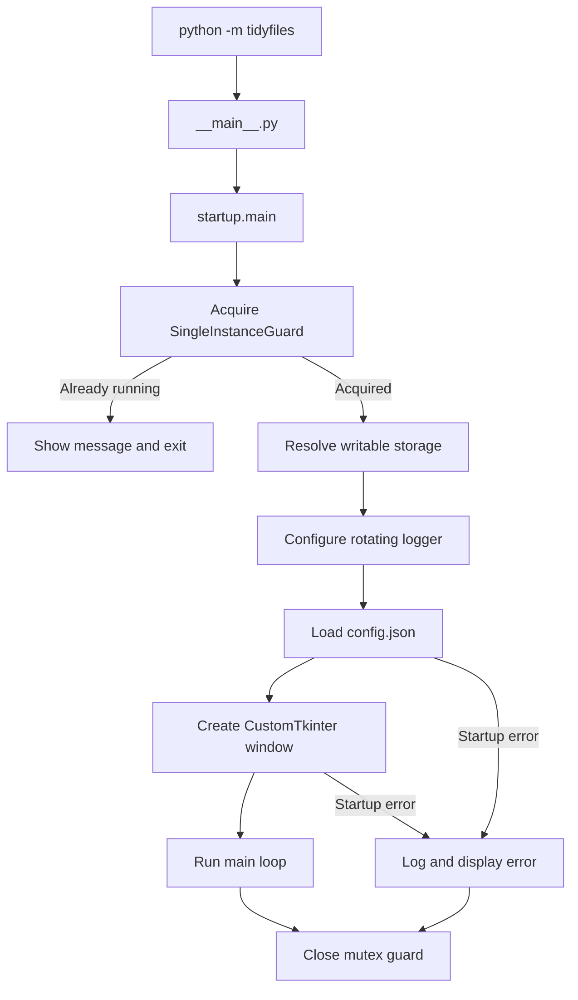

# Architecture

TidyFiles currently consists of a small Python package with a Windows desktop
shell and foundational startup, configuration, storage, logging, and
single-instance modules. The pure filename engine is implemented as a library
component but is not connected to the GUI. The shared in-memory collection
domain model supports ordered snapshots and import-session finalization or
rollback. Read-only, GUI-independent discovery and filename-evaluation
services are implemented; the GUI does not call them yet. A finalized
collection snapshot can be adapted to the pure filename engine, including
on-demand physical directory counts. Preview rendering, destination planning,
and filesystem processing remain planned.

## Startup and shutdown

The second-instance path ends before storage selection, logging, configuration
loading, or GUI import. The guard remains held through the GUI event loop and is
released on orderly shutdown. Bringing an existing window to the foreground is
not implemented.

## Package components

| Module | Current responsibility |
| --- | --- |
| `src/tidyfiles/__init__.py` | Package version. |
| `src/tidyfiles/__main__.py` | `python -m tidyfiles` entry point. |
| `src/tidyfiles/startup.py` | Mutex-first startup, storage/config/log initialization, error reporting, GUI launch, and orderly guard cleanup. |
| `src/tidyfiles/instance.py` | Windows named-mutex acquisition, active-owner rejection, abandoned-mutex recovery, and handle cleanup. |
| `src/tidyfiles/storage.py` | Writable application-directory selection and `%LOCALAPPDATA%\TidyFiles` fallback for ordinary application data. |
| `src/tidyfiles/config.py` | Schema-v1 defaults, validation, loading, and atomic saving, including backward-compatible sort preferences. Invalid sort values use defaults without rewriting the file during load; other invalid configuration remains an error. |
| `src/tidyfiles/logging_setup.py` | Rotating log setup with a 5 MB active file, three backups, and a no-op fallback when file logging cannot be opened. |
| `src/tidyfiles/app.py` | System-appearance CustomTkinter shell, three operation tabs, one initially empty shared Treeview, and status text. |
| `src/tidyfiles/collection.py` | GUI-independent working collection with one authoritative ordered ID sequence, indexed membership, import lifecycle, management operations, ordering mode, and immutable snapshots. |
| `src/tidyfiles/discovery.py` | Read-only file and recursive folder discovery, exclusions, metadata snapshots, one bounded background producer, batched collection updates, cooperative cancellation, and complete/incomplete/failed outcomes. |
| `src/tidyfiles/sorting.py` | Pure sort criteria, directions, natural comparison keys, legacy file categories, and deterministic ordering without filesystem access. |
| `src/tidyfiles/filename_format.py` | Pure parser producing immutable, source-ordered literal spans and token occurrences; structured parse errors retain the exact input expression, offset, and optional offending token. |
| `src/tidyfiles/filename_evaluator.py` | Pure per-file and ordered-batch evaluation of parsed tokens and extensions; returns raw values, resolved candidates, validated names, and file-specific diagnostics. |
| `src/tidyfiles/filename_integration.py` | Collection-snapshot adapter, read-only directory-count cache, structured evaluation results, request-currency checks, cooperative cancellation, progress, and one bounded background worker. |
| `src/tidyfiles/filename_validation.py` | Pure legacy-character substitution and validation of one Windows filename component, including reserved device names, Unicode safety, and UTF-16 component length. |

The shell does not import files, update the collection, evaluate parsed rename
formats in the GUI, hash duplicates, repack media, or modify the filesystem.
`collection.py` stores the selected path spelling and a separate
case-insensitive, normalized Windows path key without resolving paths or
accessing the filesystem. Filesystem object identity is optional metadata and
does not merge distinct paths. Add Folder entries retain that folder as their
first import root, while Add Files entries use each file's immediate parent;
separate Add Folder root records carry cleanup authorization. Import sessions
append provisional entries, then finalize them or remove only their own new
entries and roots on cancellation. Effective order changes do not change entry
IDs, and downstream consumers receive immutable ordered snapshots. The model
does not modify source files. `discovery.py` uses one background producer with
a 128-record queue and a default batch size of 64; only the consumer registers
results in the collection. It reports progress counters without a percentage,
and does not materialize a folder's candidate paths before traversal. Discovery
excludes the three named clutter files case-insensitively, `$RECYCLE.BIN`,
`System Volume Information`, nonregular entries, and observed reparse points.
Other app-managed locations are supplied by their actual paths through the
`managed_paths` argument; no such Trash, staging, or recovery paths are
currently defined by storage configuration. Ordinary hidden and dot-prefixed
files remain eligible. Metadata includes size, timestamps, attributes, and
filesystem identity when available; Windows directory-entry identity is
re-read without following links when the initial entry data lacks a file ID.
Coverage errors produce an incomplete import while retaining discovered
entries; exclusions do not. Cancellation drains queued work, rejects later
results, and rolls back the current import after the producer stops. The
collection retains earlier incomplete-import records. Discovery order is
provisional until all results are consumed and the import is finalized. The
collection then either sorts all retained entries in automatic mode or keeps
existing order and appends the new entries sorted in manual mode. The default
sort is File Type + Name, ascending, using the legacy image, video, document,
audio, archive, and other categories. Name, extension, size, creation date,
modified date, and path are also supported. Descending reverses the complete
known compound key, including category order; ascending preserves the legacy
category order. Missing metadata sorts after known values in both directions;
known zero values remain ordinary sortable values. The legacy HEIC suffix is
an image sort category only; this does not add conversion support.

Natural comparison case-folds text and compares decimal runs by numeric value
without converting long runs to integers. Numerically equivalent padded names
use a deterministic case-sensitive filename and then natural full-path,
normalized-path, and original-path tie-breakers. For example, `Image 001.png`,
`Image 01.png`, and `Image 1.png` sort in that order. Sorting keys use only
stored collection values and never read the filesystem. Persistent criterion
and direction live in
`global_settings.sort_criterion` and `global_settings.sort_direction`; missing
or invalid values use File Type + Name, ascending. Manual mode is collection
state and is not saved as a preference.

The collection exposes Move Up, Move Down, Move to Top, Move to Bottom, and
complete ordered-ID replacement. Multi-selection is treated as a set while
selected order comes from the collection; relative order is preserved for both
selected and unaffected entries. Unknown selection IDs are ignored, while an
invalid complete permutation is rejected. Remove from List changes only
in-memory membership and retains import-root records and incomplete warnings.
Clear All removes collection entries, import records, roots, and diagnostics,
resets automatic mode, and retains sort preferences. Both actions leave source
files untouched. Management capabilities disable sort, reorder, removal, and
clear while an import is active. No final processing-readiness gate is exposed.

Each immutable snapshot carries a monotonic revision. `is_current(snapshot)`
checks collection identity and revision so membership or effective-order
changes, including canceled imports, invalidate downstream results without
reusing a prior revision. No-op reorder and removal operations do not advance
the revision. The GUI does not yet construct or display this collection.
The scan is a metadata snapshot and does not replace M3 execution-time
revalidation. The pure
`filename_evaluator.py` module consumes an existing parsed
expression and immutable per-file metadata. It evaluates literal text, original
stems, text extraction and manipulation, stored directory names, supplied
physical counts, collection sequences, and source/output extension context.
Manipulations update a separate working stem in source order and emit each
resulting stem at that token's position. Batch evaluation derives zero-based
indexes from its ordered snapshot, normalizes Windows parent identities without
filesystem access, and reports per-file failures. Numeric widths are at least
two digits; repeated numeric occurrences share width, with `<IncNrDir>` widths
calculated separately for each parent group. `<Ext>` emits the source extension
except for terminal `.<Ext>`, which emits the intended output extension.
Extension assembly recognizes only terminal literal suffixes matching the
source or intended output extension. Each batch result retains raw evaluated
text, its extension-resolved candidate, and (when valid) the sanitized filename
separately. The nine legacy invalid characters are substituted after evaluation;
emitted text is not parsed again. Other Unicode code points and their
normalization form are preserved. Validation rejects empty or whitespace-only
names, empty generated stems, `.`/`..`, trailing ASCII spaces or periods,
controls, invalid Unicode, overlong components, and reserved DOS device
basenames (`CON`, `PRN`, `AUX`, `NUL`, `CONIN$`, `CONOUT$`, `COM1`–`COM9`,
`LPT1`–`LPT9`, and COM/LPT superscript `¹`, `²`, and `³` forms), including
device basenames followed by extensions or multiple dotted suffixes. Component
length counts the final extension and separator in UTF-16 code units, with a
default limit of 255. Batch validity fails if any evaluation, extension, or
filename validation error occurs, and an empty format cannot authorize a rename
batch. Validated candidates are still not an executable filesystem plan. The
validator does not inspect target volumes, enforce full-path limits, check
collisions, or access the filesystem.
Source and target extensions may be supplied with or without a leading dot;
their supplied spelling is preserved in candidates. An empty extension means
the source or intended output has no suffix, while `None` means metadata is
unavailable.
The parser preserves commas in final `RepS`, `RepM`, and `Ins` arguments, and
evaluation uses them verbatim.

## Collection filename evaluation

`filename_integration.py` accepts one immutable `CollectionSnapshot`, parses
the expression before metadata acquisition, creates one engine context per
entry, and calls `evaluate_batch` once in effective collection order. Each
result row retains the original `CollectionEntry`, so stable entry ID, source
path and import context remain associated even after sorting or reordering.
`<DirName>` uses the first-established import-root name; `<SubDirName>` uses the
actual immediate parent name. Per-directory numbering uses the stored
normalized parent-path identity. The engine remains filesystem-independent.

`<NumFiles>` and `<NumDirs>` trigger one nonrecursive enumeration per distinct
parent directory in that evaluation. The provider counts regular physical
files and directories, including ordinary excluded clutter files. It skips
symlinks, junctions and other reparse entries, as well as special entries;
hard-link names are counted as separate directory entries. A failed or partial
listing leaves both counts unavailable and produces per-entry diagnostics.
`<NumItems>` remains the batch size. Expressions without physical count tokens
do not enumerate directories.

The background service has one worker and retains at most one replaceable
pending request. It reports parsing, metadata, context-building and batch
progress from the worker thread; a GUI consumer must marshal updates onto the
UI thread. Cancellation is cooperative and cannot interrupt a blocked
operating-system filesystem call. Evaluation never mutates the collection.
Batch errors remain visible per entry, while any parser, token, metadata or
filename-validation error makes the entire rename batch invalid.

The service cache is a bounded 256-entry LRU for the service lifetime, keyed by
lexically normalized absolute directory path and available filesystem object
identity. Successful and failed enumerations can be reused while the identity
is unchanged. Filesystems without a usable identity are not cached across
requests. Consumers can invalidate cached metadata or submit a forced refresh;
these operations invalidate prior evaluation currency. A cache hit and an
identity check do not prove that directory contents stayed unchanged. The
result request ID, collection ID/revision, expression and settings must all
match current inputs. The GUI consumer must pass its current expression and
settings to `current_result()`; it returns no result for a changed collection,
an active import, a superseded request, or changed expression or settings. A
candidate comparison reports raw candidate changes separately from
validated filename changes, so an invalid name is never promoted to a valid
preview candidate.

An evaluation marked valid establishes only that the filename expression was
evaluated and each filename component passed validation. M2-E must separately
preserve incomplete-import acknowledgment requirements and later duplicate,
destination-collision, preflight and user-authorization checks. The evaluation
service exposes no global processing-ready flag.

Directory observations are path-based snapshots. An external process can
replace a path between no-follow component checks and enumeration, and
metadata can change after observation. M3 must independently check sources,
filesystem metadata, destination availability, volume constraints and
collisions immediately before any proposed filesystem operation.

## Tests and CI

Tests are in `tests/` and use pytest. Configuration, storage, logging, package
startup, and Windows mutex behavior have focused coverage. Windows-specific
mutex tests use independent subprocesses and temporary directories; startup
tests use isolated temporary paths and fakes so they do not require a visible
desktop.

`.github/workflows/ci.yml` runs on `windows-latest`, sets up Python 3.13,
installs `.[dev]`, then runs Ruff and pytest. It does not run `compileall`.

## Planned components

Destination planning, filesystem transactions, duplicate verification, and
repacking are future components. Their behavior is
specified in local planning references, not implemented in this package. Do not
infer implementation status from an approved requirement.

## Deferred package restructuring

M6.1 (Package Restructuring and Architectural Cleanup) is planned after M6 and
before M7. It will improve source organization and maintainability while
preserving established application behavior. A preliminary illustrative
package layout and the checkpoint requirements are recorded in
[`docs/PROGRESS.md`](PROGRESS.md). The example does not prescribe the final
hierarchy: module placement will be decided after M6 by inspecting the
implemented features and their dependencies. Until then, continue ordinary
feature development and introduce feature-specific subpackages when complexity
justifies them; do not undertake comprehensive restructuring early or combine
unrelated functionality merely to reduce the number of modules.
